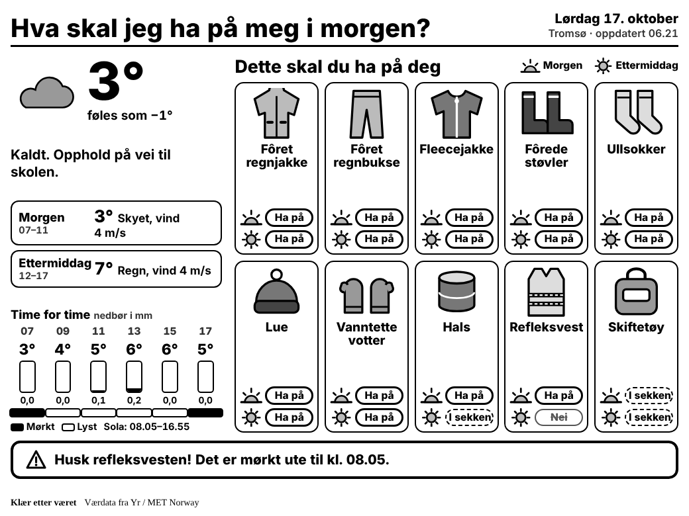

# Klær etter været

A [TRMNL](https://trmnl.com) plugin that tells kids what to wear today, based on the
forecast from [Yr](https://www.yr.no) (MET Norway's Locationforecast API). All text on
the screen is in Norwegian. It is designed for the **TRMNL X** (1040×780, 16 grays) and
scales down to the original TRMNL and to mashup slots.



## What it shows

- The weather in the morning (07–11) and in the afternoon (12–17), using the temperature
  as Yr reports it (no wind chill).
- Hour by hour temperature and precipitation, and whether it is dark or light outside.
- What to wear: **Ha på deg** (needed in the morning) as large picture cards, and a
  dashed **I sekken** box for things to pack because they are only needed later in the
  day or are optional.
- Optionally, up to three calendar events for the day with start and end times, in
  a strip along the bottom (one line each; long titles are cut off). Paste an iCal link (for Google Calendar: Settings → the calendar →
  "Secret address in iCal format"; an iCloud webcal:// link also works) into the plugin's calendar field. The transform fetches it itself, since TRMNL polling only accepts JSON. Recurring weekly
  events, cancelled dates and all-day events are handled.
- A reminder at the bottom, such as the reflector vest when it is dark in the morning.

After 17:00 the screen switches to tomorrow's plan.

## How it works

| File | Purpose |
|---|---|
| `src/settings.yml` | Polling setup and the form fields (place name, latitude, longitude, altitude, calendar, time zone) |
| `src/transform.js` | Serverless transform. Turns the Yr forecast into a small outfit plan |
| `src/shared.liquid` | Styles and the SVG icons, shared by every view |
| `src/full.liquid` | Full screen |
| `src/half_horizontal.liquid`, `src/half_vertical.liquid`, `src/quadrant.liquid` | Mashup views |
| `test/` | Tests for the transform, with a sample forecast for Tromsø |

TRMNL polls
`https://api.met.no/weatherapi/locationforecast/2.0/compact?lat={{ lat }}&lon={{ lon }}&altitude={{ altitude }}`
every hour with a `User-Agent` that identifies this project, as MET Norway's
[terms of service](https://api.met.no/doc/TermsOfService) require. Coordinates should
have at most four decimals. The altitude (whole metres, shown on the place's page on
yr.no) matters: without it MET guesses the height from its model terrain, which can make
the temperature a few degrees off. The defaults are Bjerkvik (68.5492, 17.5571, 5 m).

The clothing rules live in `outfit()` in `src/transform.js`. They work from the coldest
forecast temperature in each part of the day, the precipitation, and whether it is
dark. For example: lined rain gear at 6° or colder, mittens at 4° or colder, and a
reflector vest whenever the sun is down. In dry frost it suggests a winter suit only when
there is at least 5 cm of snow on the ground (winter suits get torn on bare ground);
otherwise it suggests a parka suit with fleece, or a thick wool sweater when it is
−5° or colder.

Yr's forecast does not say whether snow is lying, so the transform also asks NVE's
[seNorge](https://www.senorge.no) model for the snow depth at your coordinates, through the
open [GridTimeSeries API](https://api.nve.no/doc/gridtimeseries-data-gts/) (Norway only,
NLOD licence). If NVE can't be reached, it assumes bare ground. In December, January and
February it suggests a winter suit in frost regardless of what NVE says.

## Install on TRMNL

With [trmnlp](https://github.com/usetrmnl/trmnlp). The `bin/trmnlp` script in this repo
runs it through Docker, so you only need [Docker](https://docs.docker.com/get-docker/)
running (or `gem install trmnl_preview` with Ruby 4.0+):

```sh
bin/trmnlp login   # paste your API key from trmnl.com > Account
bin/trmnlp push    # creates the private plugin; commit the id it adds to src/settings.yml
bin/trmnlp serve   # local preview at http://localhost:4567
```

Then open the plugin on trmnl.com, set your place and coordinates, and add it to your
playlist.

The plugin on trmnl.com is connected to this repository (GitHub sync, repository root),
so changes merged to `main` reach TRMNL without `bin/trmnlp push`. TRMNL also commits
its own copy of `src/settings.yml` back to `main` when settings change on trmnl.com, so
pull before editing that file.

## Tests

```sh
npm test
```

## Attribution

Weather data from MET Norway (yr.no), licensed under
[CC BY 4.0](https://creativecommons.org/licenses/by/4.0/). Snow depth from NVE seNorge,
licensed under [NLOD](https://data.norge.no/nlod/no/2.0). The plugin shows
"Værdata fra Yr / MET Norway" in its title bar.
